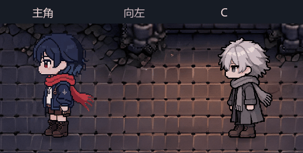

# C 侧走按主角动作重制

2026-10-26，承接5acd727，动作定稿提交`8d6eb20`。用户已确认本版并授权发布至`main`；工作分支`codex/c-hero-gait-20261026`保留。

## 当前生效版本

用户反馈八相位侧走僵硬。本版直接以主角side1—4作姿势参考，用内置imagegen重画C：收脚→迈步A→收脚→迈步B。第2帧屈肘向前摆，第4帧摆臂换侧，衣摆随迈步打开；围巾缩短以避免超出画布。身份仍为白发、灰围巾、深色长外套与长裤。

与主角同为四帧、8FPS、每轮0.5秒；第1/3帧复用同一收脚姿势。向左使用原图，向右镜像。停下回到同一收脚图，避免切换时跳姿。主角动画本身未改。

## 调用与源稿

- 当前帧：`art/npc/c/side1.png`—`side4.png`，站姿`idle_side.png`，均258×360透明PNG。多余side5—8已退出。
- C总计12张走路帧和3张站姿。正背面未改，NPC统一高度45、脚点和束缚层对齐规则保持。
- `scenes/cutscene.gd`中C侧走直接采用`Player.ANIMATIONS[walk_side]`与`Player.WALK_FPS`，剧情移动及追兵共用。
- [源稿、参考与实际提示词](../art/npc/c/source/hero_gait_v3/README.md)，导出工具`tools/build_c_sprites.py`只切片、缩放、对齐。
- 清单：`art/catalogs/c_hero_gait_20261026.json`。v2八相位仅作历史记录。

## 实机检查

全量4976/4976通过；数据14图/32剧情/7结局/11物品通过；第一章真窗口烟测通过。真GPU并排播放中主角和C均8FPS、实时帧序同步，持续追兵动画更新不重置首帧；左右实际移动结束后能回站姿。计数较4985减少9项，来自移除四张额外侧帧的尺寸/脚底检查及替换步态检查，未删整套测试。

预览取真实渲染器四相位截图，按125毫秒/帧重播；脚本暂停取帧不作为实时推进证据，实时帧序另存GPU报告。仍需用户判断动作观感，不代表整章人工通关。

[四帧对照](screenshots/c_hero_gait_20261026/four_phases.png) · [实时播放报告](screenshots/c_hero_gait_20261026/gpu_report.json)
