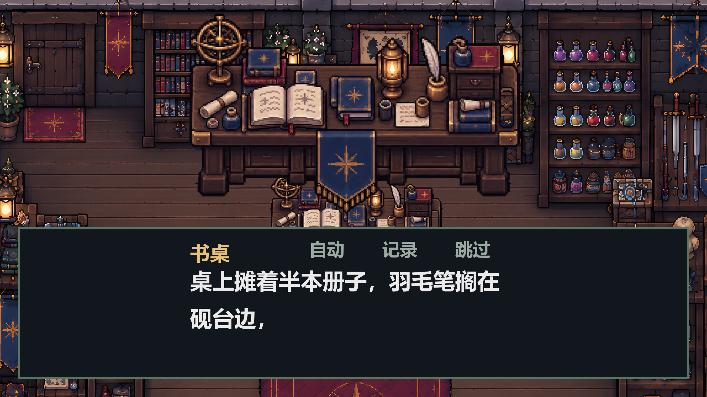
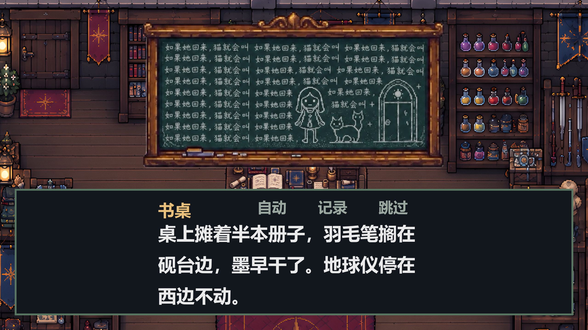
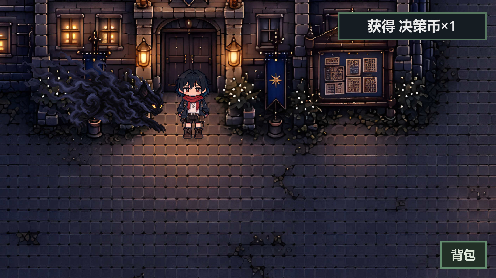
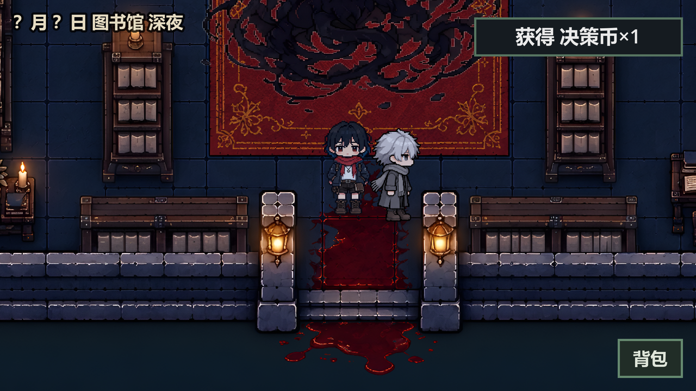

# 物件近景、追逐猫与图书馆C往返修复

基线：`ae1a7bd`；分支：`codex/fix-object-cat-library-20261026`。

- 普通非人物物件调查时显示近景，按屏幕和对话框上沿等比放大；读取当前贴图变体及视觉部件，无切图时从背景按地图坐标裁取。近景不接管输入，剧情大图出现时让位，调查结束或换图时清除。
- 剧情道具图也完整放在对话框上方，透明画布按实际可见内容取景；全屏CG仍按原流程显示。黑板素材原画布1402×1122，可见区域仅793×412，此前透明边距进一步压小了物件。
- 追逐黑猫不再按高清PNG原像素显示，改为主角显示高度的1.5倍，再乘地图标尺；脚底对齐追踪路径，跟随和QTE逻辑保持。
- 离馆再进时，按正式`ch2_diary/library_enter`节点恢复C的位置、站姿和镜像，不重播入馆剧情或发奖励。已逃离的状态不再补位；存档中已有的C位置优先于入口补位。兼容已经丢失C的旧空人物快照。

## 验证

- 数据自查：主工作区及隔离地图基线均通过，14图/32剧情/7结局/11物品。
- 全量游戏测试：隔离地图基线 **4995/4995**，退出码0，无脚本错误。新增回归覆盖猫尺寸/脚底、正式入馆后未调查连续往返、C不重复生成、存档位置优先、完成后不复活，以及普通物件/背景裁图/专用大图让位/近景关闭。
- 真窗口第一章烟测：退出码0；三项专项GPU探针：退出码0，四张截图逐一视觉检查。该结果不等于整章人工通关。
- 复现探针：`godot --path . --script res://tests/probe_object_chase_library.gd`，截图写入`user://bugfix_object_chase_library/`。

开工时已有未提交的`data/maps/classroom.json`、`school_yard.json`及几张美术素材。本次保持原样，不纳入提交。首次在混合工作区全量测试为4991/4993，两项失败是「窗下交互位置可站立」「教室门口可走到窗下」。隔离验证只将这两张地图换成HEAD已提交版本，使用本次全部运行时代码后4995/4995通过；没有用修改测试或覆盖本地地图消除失败。

现有负面用例及历史剧情绑定仍输出既有诊断，不能把测试通过描述为日志全净。

## 实机画面

普通物件近景：

透明留白裁去后的剧情道具近景：

追逐猫及前方道路：

未调查直接离馆再进，C仍在原位：

