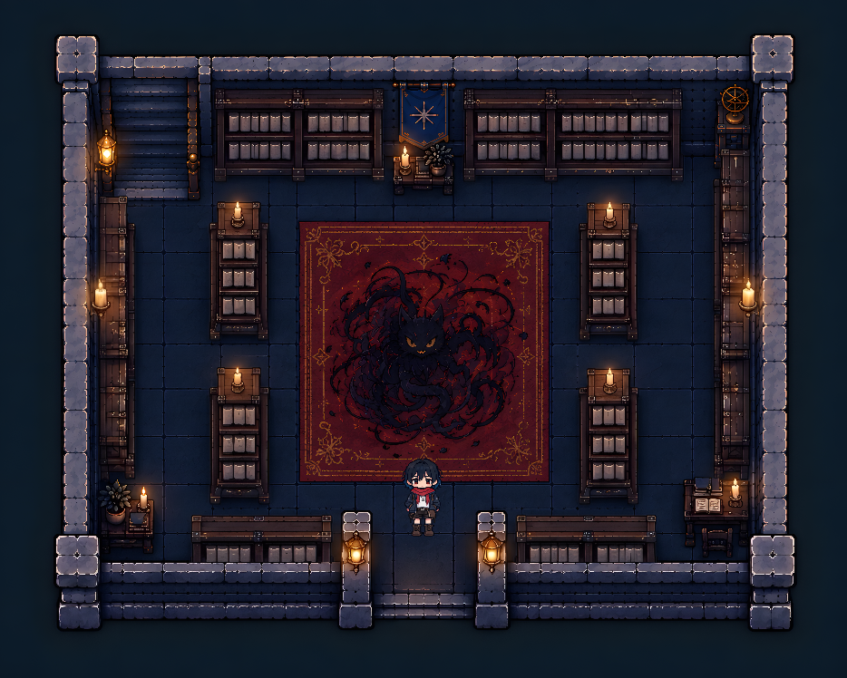
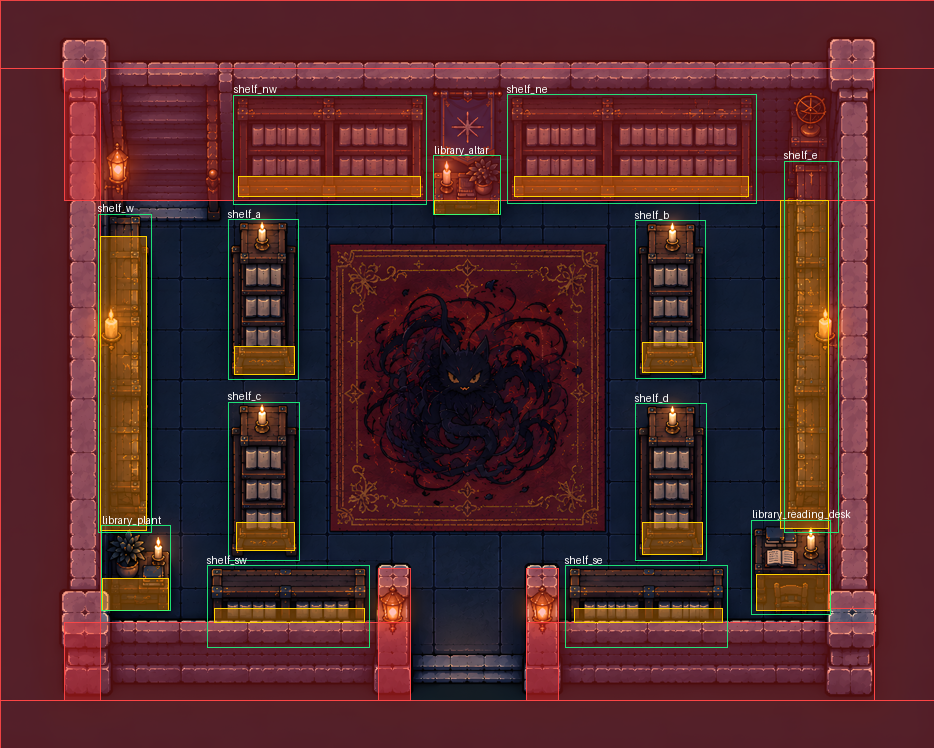

# 图书馆素材重制与碰撞初版

素材来源：`../待用资源/地图/图书馆/`。游戏文件属于 `main`；Godot 编辑插件是可选工具，见 `分支管理.md`。

## 本次落地

- 使用「图书馆1」的干净入口版本，保留 `467×374` 的既有游戏坐标系和高清底图。中央原画中的图案保留，不另外添加猫贴图。
- 将书柜表拆为十个独立透明物件：中间四个、上侧两组、左右各一个、底部两组。连体书柜以完整柜体为一件，不切断共用柜柱。
- 另拆陈设桌、盆栽烛台、阅览桌三个遮挡物，按透明轮廓保留家具，不带矩形地板块。共十三件，分别保存在 `art/props/library_*_cover.png`。
- 整张四墙素材不作为前景。`art/map/library_wall.png` 只使用底墙；其中与底部书柜重复的露出部分已去除，书柜仍由独立物件绘制。小家具的透明边缘参考四墙素材中的对应家具区域，不导入其余墙面。
- 参考「碰撞箱核对图」和实际柜脚，建立十段建筑碰撞与十三个物件局部碰撞框。遮挡默认取物件碰撞上边缘，未写手动 `cover_y`。移动物件时碰撞会跟随，修改碰撞上缘会同步调整自动遮挡。
- 出生点放在下方入口内侧。原有四个书柜交互和中央旧交互保留；新增家具只作装饰，没有虚构新剧情。

碰撞是供后期精修的初版。核对图不是最终不可变规范；需要由策划在实际试走中调整物件局部框和建筑边界。

## 素材文件夹里的两个 JSON

| 文件 | 检查结果 | 本次处理 |
| --- | --- | --- |
| `提取的walls.json` | JSON 数据，不是可执行代码。包含 52 个矩形，很多只有 2～3 像素宽或高，是像素标记提取留下的碎段。 | 用作位置参考，未原样导入。 |
| `重新生成的library.json` | 旧地图替换草案：包含 16 段墙、四个书柜遮挡引用及一个 `library_cat_cover.png` 引用；没有提供对应完整切图交付。 | 不覆盖现有地图，也不采用新增猫遮挡，按本次要求重新构建。 |

「小人正面」「小猫抠图」「猫」这三份独立素材未使用。它们与游戏已有玩家行走帧、底图原画是不同资源。

## 继续精修与检查

在插件分支打开 `IF 场景`，选择 `library`。四个中间书柜沿用 `shelf_a`～`shelf_d`；其他书柜使用方位后缀，三处家具使用 `library_altar`、`library_plant`、`library_reading_desk`。局部碰撞属于物件，建筑墙仍在地图墙列表。

书柜上下两侧均已用游戏 `WalkGrid` 检查可达，并验证实际物理碰撞阻止穿柜。`tests/probe_library.gd` 使用真实 `MapView` 和玩家，支持无头定向检查及后台渲染前后遮挡截图。检查跟随地图数据取坐标，不固定碰撞框的精修数值。

美术重切工具为 `tools/prepare_library_art.py`，需要 Pillow；它只生成图片与中间布局清单，不直接写地图。插件分支的 `tools/rebuild_library.gd` 使用编辑器数据层保存地图。重建会覆盖本张地图的几何初版，后续人工精修后不要无故重新运行。

学校大门通往图书馆的既有事件仍为「门锁着」，本次不改变解锁剧情；可从编辑器的 `library` 试走核对。

