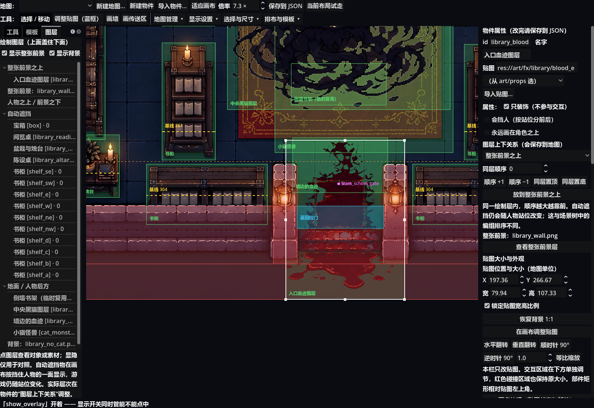
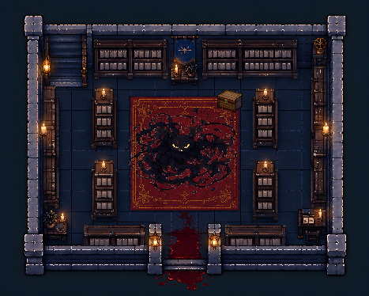
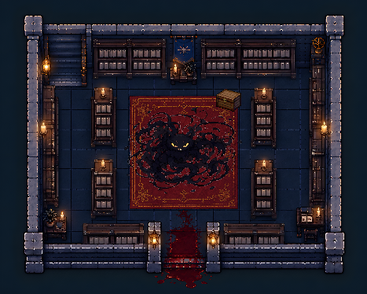

# 绘制图层与图书馆血迹遮挡

基线`b1af70f`；分支`codex/editor-draw-layers-20261026`。

## 原因

图书馆的`art/map/library_wall.png`是一张透明前景，包含入口门柱、下墙和台阶。入口血迹是独立物件，默认普通贴图层5，整张前景在13，因此台阶遮住了血迹。它不是名为“台阶”的独立actor，原场景树又没有列出整张前景，造成找不到遮挡来源。

原编辑器还存在显示差异：先画前景、后画人物前层，但游戏的人物前层12低于前景13。本轮将编辑器顺序修正为人物前层在前景之下，并新增明确的「整张前景之上」14；勾旧「永远画在角色之上」不再在编辑器里假装能够越过前景。

## 改动与兼容

- 左侧新增「图层」页，列出绘制带、物件、整张前景素材和背景；支持选择定位和临时显隐对照，显隐与原显示设置同步，不写地图。
- 属性卡新增「图层上下关系」，可继承旧设置，或指定地面、自动遮挡、人物之上、整张前景之上；提供血迹所需的快捷按钮和同层顺序/置顶置底。
- `MapDef.Actor`新增可选`draw_layer`和`draw_order`：前者空串继承原`over/cover/visual_parts`，或为`back/auto/front/above_overlay`；后者有限整数，默认0，数值越大越靠前，平局保留原数组顺序。显式层覆盖该物件全部部件；旧地图不迁移、不自动加字段。
- `MapDef.ordered_actors`稳定排序副本，编辑器与游戏共用；同层顺序通过真实节点创建/绘制次序处理，不给z任意加偏移，避免跨越人物或前景。变体切换保留图层，几何、交互和碰撞保持。
- 自动遮挡在画布按抬升态显示；游戏会随人物越过基线变层，因此它与地面层重叠的所有站位组合仍需试走，不把静态列表说成动态通关证明。
- 正式地图、源素材以及用户当前未保存布局没有自动修改。入口血迹的层设置由用户在编辑器中选择并保存。

## 验证

- 新数据/运行时专项70/70；图层属性卡与列表34/34。
- 插件全量 **4635/4635**，退出0，无脚本错误。
- 游戏全量：已提交地图的隔离基线 **5065/5065**，退出0，无脚本错误；主工作区与隔离数据自查均14图/32剧情/7结局/11物品。
- 真实图书馆GPU对照 **13/13**：普通层和人物前层仍被台阶覆盖；前景之上时血迹露出，编辑器与游戏显示同一遮挡层；图层入口、前景定位、显隐同步与JSON往返通过。游戏世界像素材质和编辑器原图存在少量采样色差，对照按层判断而非宣称截图逐字节相同。
- 第一章真窗口烟测和完整编辑器构造探针通过。保留既有窗口位置、配置负面用例及游戏负面诊断，不称日志全净。
- 工作区已有未提交教室、校门、操场布局及美术不纳入本次提交；隔离游戏验证仅将这三张地图替换为已提交版本，未覆盖主工作区。

复现：`godot --path . --script res://tests/probe_map_draw_layers_ui.gd`。只操作内存图书馆副本；输出`user://map_draw_layers_probe/`。不等于整章人工通关。

## 画面

图层页与物件设置：

实际游戏原层次与前景之上：

