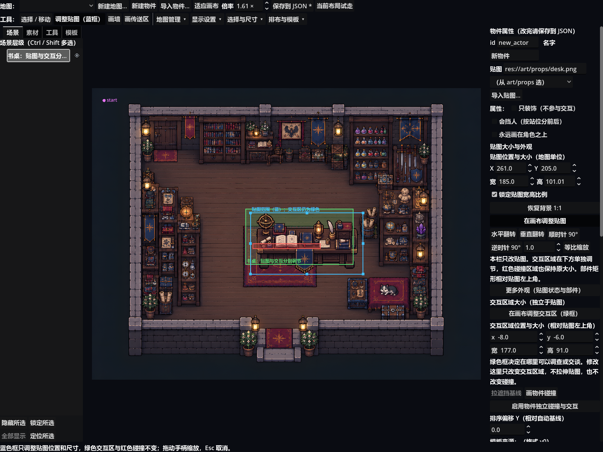

# 地图编辑器：贴图与交互区域独立调节

基线`5473cd6`；工作分支`codex/editor-independent-texture-reach-20261026`。

## 本次解决的问题

底层已有独立的贴图`rect`与交互`reach_local/reach`，但普通画布八个手柄只修改交互区，贴图宽高入口又被长属性卡挤到下方。本次补齐独立的蓝色贴图调整模式，并把两组尺寸入口前置，不改主角、相机或正式地图数据。

- 蓝框八个手柄缩放贴图，框内拖动只移动贴图；绿色世界交互区和红色碰撞保持原位置/大小。
- 绿框手柄调整交互区；贴图和碰撞保持。普通选择主体拖动仍整体移动物件。
- 贴图数值支持X/Y、宽高、默认等比锁、倍率和背景1:1；交互区域另有独立数值。拖动、修改、撤销/重做后两组读数同步，不打断连续输入。
- 新导入或素材拖入后自动进入蓝框模式；连续拖入仍可用。锁定、隐藏、编组、多选按现有保护规则拦截；高级变体/部件默认收起。
- 一次拖拽只在松手时提交一次；取消、失焦、切图、外部数据变化不会留下半笔改动。地图继续使用现有数据格式，未增加公共字段或迁移。

## 验证记录

- 插件全量：**4531/4531**，退出0，无脚本错误。
- 新画布专项：77/77；原画布与碰撞专项：849/849；均退出0。
- 真窗口独立插件UI：**24/24**，覆盖素材拖入、蓝/绿框真实鼠标拖动、两组数值、碰撞保持、撤销/重做和临时地图保存回读。截图已逐项视觉检查。
- 编辑器构造/完整探针通过。修正旧探针把素材筛选结果固定为一张的断言，允许同名前缀的已提交素材变体；仍检查筛选结果和原素材存在。
- 游戏全量：已提交地图的隔离基线 **4995/4995**；数据自查主工作区及隔离基线均为14图/32剧情/7结局/11物品；真窗口第一章烟测通过。
- 主工作区原有教室/操场未提交布局及素材均未修改或纳入本次提交。隔离游戏验证将这两张地图取已提交版本，以免把既有教室窗下两项可达性失败混入插件验收。
- 插件测试仍保留历史窗口位置诊断与负面配置文件诊断；游戏保留负面用例诊断，不声称日志全净。

复现真窗口验收：`godot --path . --script res://tests/probe_map_texture_reach_ui.gd`；探针使用内存地图，临时JSON与截图写`user://map_texture_reach_probe/`，不保存正式地图。

## 实机截图

