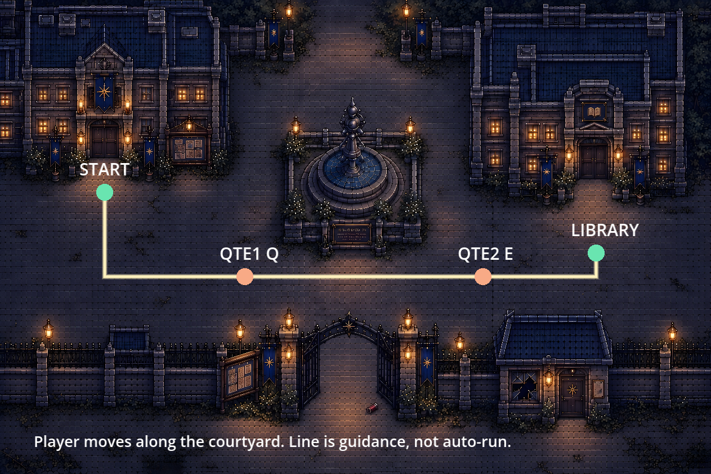

# 今日追赶任务与校门双QTE追逐策划案

## 今日追赶任务与交付

2026年10月24日  D3追赶版  每人120分钟  程序接收执行

今天优先把秋千救C做成可玩的完整闭环，接好新音效；追逐按本单做两点QTE原型，再接正式剧情。以本轮最新进度为准：救援整体未完成，图书馆仍是独立区域，不能按已交付完成排期。

| 当前事实 | 执行口径 |
| --- | --- |
| 救C小游戏与剧情未完成 | main已有基础判定及eb2dc4a束缚联动代码，先跑现有版本、补缺口；组件存在不代表完整剧情验收通过。 |
| 图书馆已有地图，未接主线 | 不重搭地图。正式链为教室日记→校门追逐→两QTE成功到门口→进馆。 |
| 日记美术已做但漏包 | 继续跳过出图；文本先联调，不因缺图片停工。 |
| 三条新救援音已交 | 已替换项目旧版，保留原调用路径。黑雾猫已生成透明单图，等待程序引用。 |

### 程序今天两小时

| 分钟 | 必须做什么 | 当天交付 |
| --- | --- | --- |
| 10 | 同步最新main与本单资源，确认现有救援代码的实际阻断。 | 锁定分支、入口及本次改动路径。 |
| 45 | 从正常秋千交互走通：C受困→判定→成功/失败重试→解绑与赠御守→回到可操作状态。 | 一条真实可玩救援链；复用已有代码，不新造第二套。 |
| 15 | 接入并听验三条新音，查练习/正式次数、重试复位与奖励去重。 | 成功/失误/最终完成各响一次，不循环、不叠响。 |
| 30 | 独立测试入口实现校门两QTE首版：可控跑动、Q/E提示、收缩圈、超时/成功出口。 | 原型能测两个点。未接正常剧情前标为开发原型，不能说已通章。 |
| 20 | 定向测试、仓库闸门和交接；通过后提交推送。 | 提交号、短录屏、通过/未通过清单。未通过不推。 |

救援45分钟内仍有阻断时，30分钟QTE预算转为修救援；追逐需求保留到次日，不用未测代码凑“完成”。今天不同时承诺接完整图书馆两遍、回溯和章末。

## 校门追逐路线与两个触发点

地图school_gate，逻辑421×281，player_scale=0.5；背景6144×4096。所有坐标均为地图逻辑坐标、人物脚底，不是PNG像素。路线只是引导，玩家用WASD/方向键移动，不自动寻路跑完全程。

| 位置 | 锚点与处理 |
| --- | --- |
| 起点 | 教学楼门外near_classroom=[62,114]。先下行到[62,164]，再沿雕像南侧向右。 |
| QTE1 | 推荐画面点[145,164]，提示Q。按x进度首次达到145触发，覆盖当前可走Y范围；从上侧绕行也不能跳掉。 |
| QTE2 | 推荐画面点[286,164]，提示E；仅QTE1成功后、进度首次达到286触发。 |
| 终点 | 门前[353,164]为接近点；正式portal为[341,76,24,78]。两次成功且到门前接近区[338,148,30,30]，再接管短入门/切馆。 |
| 已查通路 | [62,114]→[62,164]→[145,164]→[286,164]→[353,164]→[353,150]，按现有WalkGrid每2像素检查，5段全通。 |

先绕雕像南侧，不穿喷泉直线。门前接近区是追逐控制器的新判定区，不扩大普通地图传送区。地图更新后重新查通路；本次未验证追逐手感。

## QTE判定规则

两个点使用同一圈式QTE模块。首次显示一次无倒计时说明：“向右跑到图书馆。出现字母时，在圆圈收完前按下它。”玩家确认后才开始；不在读说明时追杀。

| 项目 | 首版规则 |
| --- | --- |
| 跑动段 | 玩家控制移动；镜头跟随并略偏向前方。目标始终是右侧图书馆。关闭鼠标自动走、普通调查及去其他地图的传送，保留暂停。 |
| 黑猫逼近 | 黑雾在主角后方沿通路追近；跑动段只营造压力，不另加血量、体力或隐藏秒杀。失败由QTE超时统一判定。 |
| 触发预告 | 触发线上给约0.3秒扑近/音效预告，随后显示按钮和收缩环；两点只触发一次，不因来回走重复弹。 |
| 按键与时限 | QTE1：Q，真实时间1.4秒；QTE2：E，真实时间1.2秒。是首版起调值；显示什么就只判什么。Q/E避开移动键。 |
| 画面 | 上中部约[160,58]显示字母按钮，外圈从半径约28缩至16；在320×180视口仍需清楚。环与字母由UI绘制，不再等一套新贴图。 |
| 慢动作 | 世界速度建议0.2倍；QTE期间短暂接管移动，让猫扑击慢放。UI动画、倒计时与按键响应按真实时间走，不能被0.2倍拉长。 |
| 成功 | 按钮出现后至时限结束前，按一次新的正确按键即可，不要求等环到某一黄区。停计时、清环，播放约0.2秒闪避；猫后退/停顿，恢复一段安全距离，归还移动。 |
| 错误输入 | 错键短红闪，不重置或延长计时；仍可补按正确键。提示出现前一直按住、键盘长按重复事件不算新按下。 |
| 失败 | 圈收完仍无正确输入，锁定失败一次；先恢复时间和镜头，再演猫追上、转失败CG与End5分支。同帧输入/超时按事件时刻处理，避免正确按下后又判死。 |
| 暂停与失焦 | ESC及窗口失焦暂停追逐和倒计时；恢复后从剩余时间继续，不补算暂停期间时间，不读暂停菜单按键为QTE。 |

两个QTE都成功后必须可以赢，不加“必败第三次突袭”。若保留C门口解围，只作为到门后的安全短演出，不夺走玩家成功，不追加判定。

## 追逐演出与镜头收尾

| 阶段 | 玩家看到与做什么 | 程序处理 |
| --- | --- | --- |
| 进入 | 日记调查结束、确认逃向图书馆；从教学楼门外开始。 | 存追逐前检查点，保存镜头/时间/音乐/输入状态，QTE计数清零。新流程才创建黑雾。 |
| 跑到QTE1 | 玩家先下到前路，向右绕雕像；猫尾雾逼近。 | 可控跑动。进度线x=145触发；暂时禁止其他门和调查截走剧情。 |
| QTE1 | 慢动作，显示Q及收缩圈。 | 新Q按下成功：闪避、猫后退；超时：转失败。 |
| 中段 | 玩家继续向右；猫重新接近，目标仍可辨认。 | QTE1完成不重触发；下一进度线x=286。 |
| QTE2 | 慢动作，显示E及收缩圈。 | 成功不立即传送；玩家继续跑至图书馆门前。超时转失败。 |
| 安全进馆 | 两次成功后到达门前，完成短入门或门口接应。 | 此时才写ch2/chase1_clear=true及ch2/library_open=true，清追逐后goto library/from_school_gate。 |
| 被猫追上 | 约0.4秒扑近/压黑，显示校园追逐失败画面与结局字卡。 | 使用既有end4_iron（正文End5“不可违的铁律”），不新增错位结局ID；提供重试与返回标题。 |
| 重试 | 回到教学楼门外，重新挑战两个QTE。 | 恢复追逐前背包/剧情快照；两QTE标记、黑雾与临时UI重建，未成功不能保留图书馆开放。 |

### 镜头首版数值

以进入前的相机基准倍率计算：跑动约×1.05，QTE约×1.15，0.15至0.25秒过渡；不写死绝对zoom。校门基准随player_scale计算，直接设1.15会把现有相机改错。GameCamera已有shake，先以实际屏幕2至3像素短震起调，QTE出现/闪避/被追上各一次，不全程剧烈抖动。

按键UI固定在屏幕，不跟相机抖；边界内缩放，不露黑边，路线和图书馆方向必须看得见。成功、失败、重试、读档、切图、回标题均走同一清理：恢复原时间倍率、原镜头倍率/偏移、输入、普通传送与音频状态，移除圈、黑雾及定时器。

闪避先用短位移或侧身表现，不等新动作帧。位移用现有可走判定，不能穿雕像/墙；没有安全落点时用原地躲避＋猫后退，不能把玩家挤死。黑雾先用单图轻伸缩与位移，不冒称已有逐帧跑步动画。

## 资源路径与程序接入位置

| 资源或接口 | 实际文件及用途 |
| --- | --- |
| 新救援成功音 | audio/sfx/rescue_success.wav；0.441秒；单次判定成功。 |
| 新救援失误音 | audio/sfx/rescue_mistake.wav；0.372秒；单次失误。 |
| 新救援完成音 | audio/sfx/rescue_complete.wav；1.254秒；最终完成。不与最后一次success叠响。 |
| 新黑雾猫 | art/npc/shadow_cat/chase_mist_right.png；1536×1024、RGBA透明、右向单帧。保留原图，游戏按约32×21逻辑像素起调，勿把整张原尺寸放地图上。 |
| 救援已有代码 | data/events/ch2_swing.json、ui/rescue_panel.gd、scenes/c_rescue_binding.gd、scenes/cutscene.gd；素材在art/fx/rescue_c/与art/ui/rescue_c/。scenes/main.gd已用同名三音路径。 |
| 地图与入口 | data/maps/school_gate.json：near_classroom、to_library、to_library_locked；data/maps/library.json：from_school_gate。不要重做图书馆底图。 |
| 新追逐能力 | 建议新增scenes/chase_controller.gd及ui/chase_qte_panel.gd（现在没有）。玩家可控移动＋实时圈式QTE与现有救援滑条不同，复用输入/暂停/演出接口，不强塞救援rescue命令冒充追逐。 |
| 追逐失败CG | 建议art/cg/ch2_chase_failure.png，当前缺正式对应图。美术先出一张校门黑雾追上的近景；临时用校门背景＋黑雾定格接结局。现有猫闪过是梦境卧室，不作正式校园失败CG。 |

音频均为44.1kHz、双声道、16bit，峰值检查无削波；保留用户原始声音，未擅自做响度重混。资源已入库不等于完整救援触发已通过听验。来源/哈希见audio/catalogs/rescue_audio_update_20261024.json及art/catalogs/chase_mist_20261024.json。

### 状态写入与边界

追逐只在教室调查/日记前置完成且选择图书馆后进入。推荐新flag为ch2/chase1_active和ch2/chase1_clear；两次QTE编号是本次会话状态，重试清零。到门前成功后才开放图书馆，不能在进校或救C成功时提前开馆。新增flag和门口判断需程序落地，本文不宣称已经实现。

使用地图编辑器保存地图触发修改；不在正式地图JSON手写一堆坐标。若用新的导演命令衔接追逐，需同步指令校验、执行、读档回放和测试；演出结构稿中的requires_work是开发需求，不是现成原生命令。

## 其他成员今日任务与追赶顺序

| 岗位 | 120分钟内具体工作 | 交付 |
| --- | --- | --- |
| 主美术 | 10同步＋65校园被猫追上CG首版＋25人物/环境一致性检查＋20交接。优先校门石路、主角黑发红围巾、黑雾黄眼，不刻画伤口；有稿先修。 | 1张1672×941首版与可编辑源稿，留文字区。未过验收就用临时定格，不把别的梦境图当正式图。 |
| 第二美术兼整合验收 | 10同步＋35校门路线/两点可见性与QTE屏幕小样＋30 C与束缚静态/运行对位检查＋25新图入库命名和透明边＋20交接。 | 两点显示预览、视觉问题清单、CG/黑雾使用说明。无运行版就标静态预检；今天不再重画C或黑雾。 |
| 文案 | 10同步＋40救C入口/练习/成功/失误/重试/御守节点包＋25追逐说明/两点短提示/End5失败字卡＋30图书馆入口与首遍三调查包＋15交接。 | 按触发—正文—选择—结果—重复调查—声音提示整理。日记文字可先录；进馆前置不能跳掉。 |
| 音效音乐 | 10同步＋25三条新救援音触发核对＋30追逐预警/闪避/被追上选用或短音首版＋35声音触发与停止/暂停表和试听＋20交接。 | 文件—触发—循环—停止条件表。已有三音不再制作；猫叫/脚步/开门先复用，追逐声音缺项明确标记。 |

### 接下来的制作日

D4程序优先钥匙/教室日记→校门追逐正式触发→成功进馆，先做最小主线；100分钟制作/验证＋20分钟同步。D5推进图书馆首遍、背刺与完整背包回溯。D6推进二遍证据、既定后续逃离、B/老人交付与End7并冻结。每人仍只120分钟，复杂CG、全新自由追踪AI和多段追逐地图先让位。

本次用户指定的是教学楼出口到图书馆的第一段追逐，不自动拿这条校门猫追逐替代后面C追逐/教室抛御守。后段可以复用同一QTE模块，但剧情、触发和结局另接。

D7至D9仍保留润色：阻断/存读档→视听与操作反馈→最终通关打包。D4若进馆还不通，立刻停新CG/附加玩法；D6若主线仍未通，明确报告需延后或缩减，不能把未开发完说成润色，不安排额外加班。

## 程序验收清单与完成口径

| 检查 | 必须看到的结果 |
| --- | --- |
| 正常入口 | 从正常秋千交互可进入救援，不只靠开发跳转；结束回到正确地图和状态。 |
| 救援线态 | 练习不解绑；正式0/1/2成功对应01/02/03；3成功全隐藏，04仅备用。 |
| 救援失败/奖励 | 失败与重试能恢复判定和线态；御守只给一次；离开重来不重复演成功。 |
| 三条新声音 | 实际加载本次新文件；成功/失误/最终完成触发正确，重试无遗留或叠响。 |
| 可控路线 | WASD/方向键真正控制从教学楼到图书馆；不能被一条自动位移动画替代。 |
| 两个触发点 | 各触发一次，按顺序Q后E；绕路也不能跳点；提前进入门口不能漏过QTE。 |
| 计时与输入 | 0.2倍慢动作时窗口仍是1.4/1.2真实秒；新按键有效；错键不续命；超时只结算一次。 |
| 暂停 | 暂停/失焦10秒后恢复，环与剩余时间不跳过；菜单按键不被当成QTE。 |
| 成功进馆 | 两点成功并到门口才切library/from_school_gate；不设置必败第三点，不提前发晶石或玩偶。 |
| 失败CG/结局 | 任一QTE超时均猫追上→清理→失败画面→End5。缺正式CG时注明临时图，不宣称美术已完成。 |
| 重试/读档 | 重试从追逐前重来，双点标记清零，背包不变；半途读档按检查点重启，不恢复半个慢动作。 |
| 清理 | 成功/失败/重试/切图/回标题后，时间、镜头、菜单、传送、输入和音频均恢复；无黑雾或环残留。 |
| 最终交付 | 短录屏＋提交号＋通过/未通过清单。仓库必跑验证通过才推送；独立原型不冒称正式剧情已接。 |

本轮已做：审核更新三条音效、生成并导入黑雾猫、查验校门地图与静态通路、交付策划和演出结构。救援闭环、圈式QTE、慢动作、正式进馆与失败CG流程仍由程序按本单接入并验收。
