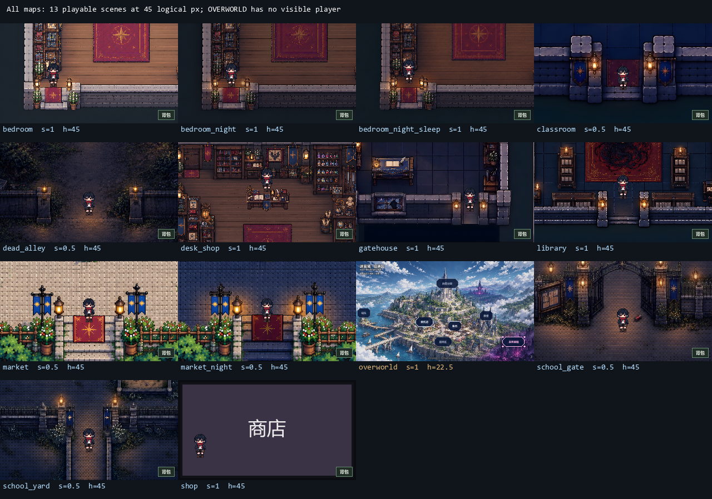

# 角色与地图尺度技术规范

版本：2026-10-26。适用于当前全部 14 张地图、游戏运行时和地图编辑器内试走。

## 1. 固定标尺

- 游戏基准视口为 **320×180**。所有可行走场景的主角帧图显示高度统一为 **45 个逻辑屏幕像素**，基础脚底碰撞显示为 **16×16**。
- 同一朝向、同一动画帧在不同场景必须等大。角色帧图为 258×360，透明边缘属于素材留白；例如正面站姿的实际不透明区域约高 43.25，不能把透明留白误判成场景缩放差异。
- 窗口放大、全屏和编辑器试走面板会对整个画面等比显示。上述尺寸是逻辑像素，不是显示器物理像素。
- 可行走场景不按地图宽高适配全图。相机跟随主角或剧情焦点，抵达地图边缘时夹住；某个方向小于可见范围时，该方向居中。
- `overworld` 是无可控主角的地点选择界面，继续展示完整大地图。

## 2. 坐标和投影

保留地图编辑器保存的原始坐标。地图、物品、局部碰撞、交互区、遮挡基线、出生点、剧情路径、镜头焦点和存档位置均不迁移。

现有 JSON 字段 `player_scale` 记作 `s`，继续表示主角在这张图原始坐标中的美术标尺，要求为大于零的有限数。它与相机共同工作，不能再单独用来改变屏幕上的主角大小。

```text
角色在地图中的高度 = Player.DISPLAY_HEIGHT × s
可行走场景相机倍率 = 1 / s
主角显示高度       = 45 × s × (1 / s) = 45
地图等效展示尺寸   = 原始地图尺寸 / s
相机可见地图范围   = 基准视口尺寸 / 相机倍率
```

这是对整幅世界的统一投影：背景、前景、所有物品一同等比例显示。任意两个物品的相对位置、相对尺寸和遮挡关系均保留。**不得只放大背景，或单独移动家具补偿比例。**

人物另共用统一角色标尺：演出 NPC 的 `height` 为逻辑显示高度，制作时在地图坐标中乘 `s`，投影后恢复为原 `height`。A、B、C、老人统一使用 Player.DISPLAY_HEIGHT（45）。2026-10-26 起，旧 C=32、B=40/42 的身高设定已作废，旧剧情/存档由创建入口自动归一。脚底坐标和路径不变；蹲姿保持自然姿态，不按可见轮廓强拉伸。

不得为了落地这套规则给世界追加带缩放的父节点。现有演出、存档和交互使用世界坐标，直接缩放父节点会改变这些坐标的含义。鼠标使用 `get_global_mouse_position()` 反投影，不另写屏幕坐标换算。

## 3. 全场景标定表

所有可行走场景的最终主角高度均为 45。等效展示尺寸用于解释统一标尺后的地图大小，**不是要求改写 JSON 的 `size`**。

| 地图 ID | 原始尺寸 | s | 相机倍率 | 等效展示尺寸 | 参照与处理 |
| --- | --- | --- | --- | --- | --- |
| desk_shop | 463×378 | 1 | 1 | 463×378 | 沿用木门基准 |
| bedroom | 463×378 | 1 | 1 | 463×378 | 与委托屋同套家具尺度 |
| bedroom_night | 463×378 | 1 | 1 | 463×378 | 与卧室白天一致 |
| bedroom_night_sleep | 463×378 | 1 | 1 | 463×378 | 与卧室白天一致 |
| market | 557×314 | 0.5 | 2 | 1114×628 | 按中央铺子门身校准，新增标定 |
| market_night | 557×314 | 0.5 | 2 | 1114×628 | 与白天集市一致 |
| gatehouse | 384×307 | 1 | 1 | 384×307 | 沿用当前家具尺度 |
| library | 467×374 | 1 | 1 | 467×374 | 沿用书架、桌椅尺度 |
| dead_alley | 384×256 | 0.5 | 2 | 768×512 | 沿用现有铁门参照比例 |
| school_gate | 421×281 | 0.5 | 2 | 842×562 | 沿用门口和建筑比例 |
| school_yard | 316×211 | 0.5 | 2 | 632×422 | 沿用秋千架比例 |
| classroom | 384×307 | 1 | 1 | 384×307 | 沿用桌椅、全身镜比例 |
| shop | 320×180 | 1 | 1 | 320×180 | 文字占位场景，无实体参照 |
| overworld | 640×360 | 1 | 全图适配 0.5 | 320×180 | 无主角的地点选择界面 |

委托屋原有记录中的门框高为 50.4 地图单位，主角采用 45。集市中央铺子门身视觉估算约 23 地图单位，统一投影后约 46，故昼夜均取 `s=0.5`。后巷铁门、学校建筑和操场秋千架同时用于核对人物与环境的相对大小。

除已有委托屋记录外，上述门和设施数值属于视觉近似，不作为精确测绘结果。门卫室和图书馆底部门洞包含俯视地板纵深，不能把这段纵深当竖直门高；也不能用远景小门强迫整张有透视的插画拥有统一物理比例。

## 4. 新地图或换图时的操作

1. 在地图编辑器中检查背景、覆盖物件和前景的实际组合，优先选择同景深的完整门扇，其次选择镜子、桌椅或人物设施。
2. 先确定环境应呈现的大小，再标定 `s`。若门在原地图中高 `D`，期望其在基准视口中高 `T`，则 `s=D/T`。例如门高 25、期望显示 50，可取 `s=0.5`。透视图须结合可行走位置复核。
3. 经编辑器数据层设置并保存标尺，保存前备份。不要逐件修改物品坐标来实现整图缩放；昼夜、睡眠等同布局变体使用相同标尺。
4. 用「当前布局试走」检查人物、门、通路、交互和地图边缘。编辑画布的「适应画布」只帮助排布，不能作为游戏相机的显示标准。
5. 检查旧存档和剧情中的脚底/头部落位、路径与焦点。比例调整不改坐标；头部锚点按角色真实变换计算。

当前标尺字段由地图编辑器数据模型维护，尚无专用标尺数值面板；程序批量处理时必须调用 `map_edit_model.gd` 的载入、历史及 `save_to()`，不得绕过备份直接覆写地图 JSON。本次集市标定和操场标尺恢复均通过正在运行的编辑器数据层保存，并比较了布局字段，保持原样。

## 5. 关联行为及实现入口

| 行为 | 约束 | 实现入口 |
| --- | --- | --- |
| 主角画面高度 | 固定 45 | `scenes/player.gd`：`DISPLAY_HEIGHT`；`scenes/game_camera.gd`：`room_zoom_for()` |
| 相机跟随与夹边 | 使用 `view / zoom` 计算可见世界范围 | `scenes/game_camera.gd`：`follow()`、`position_for()`；`scenes/main.gd`：`update_camera()` |
| 手动和鼠标路径移动 | 地图速度为 `96×s`，显示速度恒为 96 逻辑像素/秒 | `scenes/player.gd`：`movement_speed()` |
| 默认演出步行 | 按当前地图移动速度推算时长；显式 `time` 保留剧本值 | `scenes/cutscene.gd`：`_walk_player()` |
| 演出 NPC | `height` 为统一显示高度，制作时乘地图 `s`，脚底碰撞同步；配方与快照保留原始高度，恢复不重复缩放 | `scenes/cutscene.gd`：`_make_actor()`、`_add_actor_body()`、`snapshot_actors()` |
| 自由走动脚步 | 地图距离阈值为 `24×s`，显示步距恒为 24 | `scenes/main.gd`：`_update_footsteps()` |
| 头部落位 | 使用角色真实变换后的头部偏移 | `scenes/player.gd`：`head_offset()`、`place_head_at()` |
| 震屏 | 屏幕幅度不随地图标尺变化 | `scenes/game_camera.gd`：`_process()` |
| 编辑器试走 | 按基准视口计算统一面板倍率，再乘 `1/s`；每帧跟随 | `addons/if_map_editor/map_object_preview.gd`：`_fit_camera()`、`advance()` |
| 碰撞和可走格 | 继续共用原始地图坐标中的脚底框，不改判定来源 | `core/walk_grid.gd`；`addons/if_map_editor/map_edit_canvas.gd` |

地图中已有交互区、剧情坐标及物件事件绑定继续沿用。本次检查中发现操场一次保存移除了原秋千交互绑定，已在保留最新摆放和碰撞的前提下恢复 `ch2_swing` 绑定及原 `s=0.5`。

## 6. 验收与回归

- 遍历所有正式地图，检查真实主角贴图、碰撞和相机组合后的显示尺寸；大地图检查角色隐藏和全景。
- 用 `s=0.25/0.5/1/2` 验证实际物理帧移动、默认演出步行时长和显式时长；检查头部锚点与存读档回到原坐标。
- 同尺寸编辑器试走面板中，不同地图尺寸和标尺下的主角须等高；改变面板尺寸后仍保持统一规则，角色移动时镜头跟随并夹边。
- 真实渲染逐图截图核对人物和参照物；保留完整第一章开场真窗口烟测。

```powershell
$env:APPDATA = Join-Path $env:TEMP ('if-between-character-scale-' + [guid]::NewGuid().ToString('N'))
New-Item -ItemType Directory -Path $env:APPDATA -Force | Out-Null
python tools/check_data.py
& $Godot --headless --path . --script res://tests/run_tests.gd
& $Godot --headless --path . --script res://tests/run_map_editor_tests.gd
& $Godot --path . --script res://tests/probe_map_editor.gd
& $Godot --path . --script res://tests/probe_character_scale.gd
& $Godot --path . --script res://tests/smoke_run.gd
```

`$Godot` 指本机 Godot 4.7.2 可执行文件。以上环境变量应在专用测试 PowerShell 进程中设置，关闭该进程即恢复；截图探针只接受目录名以 `if-between-character-scale-` 开头的隔离 `APPDATA`。烟测及截图探针需要真实渲染器；自动验收隐藏辅助窗口，不操作用户桌面。新增自动回归见 `tests/test_character_scale.gd` 与 `tests/test_map_preview.gd`，逐图截图探针见 `tests/probe_character_scale.gd`。

2026-10-23 验收：游戏全量 **3566/3566**，编辑器试走独立 **105/105**，14 图真实图形探针 **113/113**，主角与 A 同框尺寸核验 **6/6**；数据检查、完整编辑器探针和第一章真窗口烟测通过。逐图显示尺寸记录见 [scale_audit.json](screenshots/character_scale_20261023/scale_audit.json)，人物同框核验见 [截图](screenshots/character_scale_20261023/market_character_reference.png)及[数据](screenshots/character_scale_20261023/market_character_reference.json)。全量测试保留原有负面用例和引擎清理诊断，不将其称为日志全净。

仅包含本次提交内容的隔离快照复测：游戏 **3566/3566**、插件 **4475/4475**。当前主工作区另含既有导航修复的 32 条回归，与本次 41 条预览回归合计插件 **4507/4507**；这些既有改动保持在工作区，不混入本次提交。

下图为同一 320×180 逻辑视口下的出生点截图汇总。大地图图注中的高度是隐藏角色节点的计算值，该界面不显示角色。



## 7. 高清纹理与像素采样

`320×180` 是逻辑坐标基准，项目使用 `canvas_items` 在实际窗口分辨率渲染。不要把逻辑视口改大后重写角色、UI 和地图坐标，也不要先渲染成 320×180 位图再放大来验收清晰度。高清验收使用 `tests/probe_map_sharpness.gd`，直接读取正式根窗口的 **1280×720 GPU 画面**。

世界层统一使用 `CanvasItem.TEXTURE_FILTER_NEAREST`：`MapView` 覆盖背景、前景和物件，`Player` 覆盖全套角色动画，`StageView` 覆盖演出人物。地图编辑器试走使用相同规则。项目全局过滤及对话框、立绘等 UI 保留原有设置；不得通过全局最近邻让全部界面跟着像素化。

最近邻消除放大时的混色，但不能恢复丢掉的细节。纹理质量按以下优先级处理：

1. **接回同源高清原件。** 教室由 1152×922 恢复为 4608×3688，校门由 1264×843 恢复为 6144×4096。两张高清源缩回旧尺寸后与旧图逐像素一致，故可替换原 PNG，地图大小与布局不变。
2. **低清切片回取高清图集。** `scenes/map_texture_source.gd` 将集市昼夜共 14 个低清切片解析为高清抠图源上的 `AtlasTexture`，不额外生成重复 PNG。清单记录源像素裁切区域，不能从物品当前的位置反推；物品移动、旋转、翻转、多视觉部件及遮挡继续使用原数据。高清透明度沿用原生图集，`filter_clip=true` 防止邻区串色。
3. **无高源时保真超分。** 后巷、睡眠卧室、无人物操场、委托屋前景、校门低清遮挡/喷泉和商店占位图使用 4 倍超分补足源像素密度。原色低频由原图锚定，保留超分生成的高频边缘；透明素材保留原 alpha 轮廓，避免家具边界和可见布局漂移。普通插值扩尺寸不能作为补回细节的证据。

不采用整图生成重绘替换正式地图：本轮生成候选没有达到目标尺寸，部分还改变了亮度和细节，均未接入生产。保真超分使用临时便携工具处理素材，运行时不依赖模型、网络或额外服务。

| 素材 | 原尺寸 | 高清尺寸或来源 |
| --- | --- | --- |
| 教室背景 | 1152×922 | 同源 4608×3688 |
| 校门背景 | 1264×843 | 同源 6144×4096 |
| 后巷背景 | 1152×768 | 4608×3072 |
| 睡眠卧室背景 | 1388×1133 | 5552×4532 |
| 无人物操场背景 | 1264×843 | 5056×3372，保留无人物版本 |
| 委托屋前景 | 1388×1133 | 5552×4532，保持透明轮廓 |
| 校门遮挡 1 / 2 | 516×116 / 646×120 | 2064×464 / 2584×480 |
| 校门喷泉 | 266×286 | 1064×1144 |
| 集市昼夜 14 切片 | 高清源的 1/4 切片 | 从 6688×3764 原生抠图取区域 |
| 商店占位图 | 320×180 | 1280×720，保留原文字与内容 |

其余卧室、委托屋、门卫室、图书馆、集市与大地图已有足够源像素，保留原高清素材。主角源帧为每逻辑像素 8 个源像素，主要地图约为 6–12 个，正常窗口下均能直接使用源细节；不是把低分辨率最终画面拉大。`shop` 仍是原有文字占位场景，不在本次工作中重新设计美术。

图集清单须先确认旧切片与高源区域同源。源图缺失、尺寸变化、裁切越界或用户替换了不同尺寸的切片时，helper 保留原纹理；不猜裁切、不移动节点、不覆盖用户自定义材质。新增素材时应保存高清原件，不再先缩成小切片。

验收同时检查 PNG 及导入后纹理尺寸、源像素到屏幕倍率、全 14 场景实际窗口截图、主角 45 像素逻辑高度、原布局和透明轮廓。`before` 探针模式是在当前素材上强制恢复旧线性过滤的对照，不能冒充旧素材截图；本轮另保留了修复前的原生窗口基线。

### 7.1 素材处理记录

8 张补全素材使用官方 Upscayl 的 `upscayl-standard-4x` 模型。模型输出再做 6 次原图 RGB 残差回投：先缩回原尺寸计算色差，再把色差放大补回高清图，逐次裁限并取整。透明度从原 alpha 精确最近邻放大 4 倍，RGB 则保留模型产生的高频细节。工具、权重、输入/输出哈希、参数和逐次指标见 [超分审计](../art/map/sharpness_superresolution_audit_20261024.json)；工具和中间候选均不参与运行时。

最终图缩回原尺寸后的不透明区域 RGB 平均误差为 0.0037–0.1443/255，亮度比为 0.999876–1.00173，透明度误差为 0；抽查 11 个地标没有位移。它们是对旧低清图的保真细节重建，不能当作恢复了从未保存过的原始细节。教室、校门属于另一种情况：找回已有高清同源文件，缩回旧尺寸后 RGBA 误差为 0，见 [同源校验](screenshots/map_sharpness_20261024/source_restore_audit.json)。

### 7.2 本批最终验收（2026-10-24）

- 仅含本次提交的隔离快照：游戏 **4352/4352**、插件 **4475/4475**、数据检查及真实窗口烟测通过，实际进程退出码均为 0。当前工作区另含用户既有地图及导航改动时，游戏为 **4354/4354**、插件为 **4507/4507**；这些差异没有纳入本次提交。
- 全部 **14 张地图**在 1280×720 实际窗口完成 **157/157** 项 GPU 核验，使用正式生产采样，`filter_replay=false`。13 个可行走场景的主角帧画布均为 **180 物理像素 = 45 逻辑像素**；大地图角色隐藏。逐纹理尺寸、实际区域、采样继承及投影见 [GPU 审计](screenshots/map_sharpness_20261024/sharpness_audit.json)。
- 完整地图编辑器探针及试走采样核验通过。保留既有负面用例、窗口位置和资源清理诊断，不声称日志全净。
- 商店仍为原文字占位图，源密度为每逻辑像素 4 个源像素：1280 窗口为 1:1，1920 窗口需放大 1.5 倍；不把它写成与主角完全相同的 8 倍源密度。

重新运行游戏以重建使用新贴图尺寸的节点。以后替换不同尺寸的源图时，必须先重新导入，再重建场景，不能只依赖已载入节点的纹理热更新。

Windows 终端启动 GUI 版 Godot 时，应使用 `Start-Process -PassThru -WindowStyle Hidden` 后调用 `WaitForExit()` 并检查 `ExitCode`，不能把终端提前返回视为测试结束。不要对正在使用的项目并行执行 `--import`；当前编辑器通过资源文件系统重导，本批隔离快照使用自己的导入缓存。

验收图：[全部场景总览](screenshots/map_sharpness_20261024/final_contact_sheet.png)；[修复前后同位置原生裁片](screenshots/map_sharpness_20261024/native_before_after.png)。对照图的 before 来自替换素材前保存的原生窗口基线，裁片均取自 1280×720 画面，无插值放大。


## 2026-10-26：C 原生重绘与 NPC 统一标尺

C 的12张64×64旧帧已替换为258×360，并补3张独立站姿；与主角正面站姿的实际可见高度同为43.25逻辑像素。正式人形NPC的标称高度统一45，创建入口对旧高度自动归一，快照不累缩。商店B占位改用已有正式图，原脚底/碰撞保留；C束缚层按新画布宽高对齐。

4970/4970、数据检查、NPC同框与操场/校门真实GPU、第一章烟测、背刺成功到End7真实自动试走通过。素材、提示词、四方向动画与验收图见[C重绘与NPC尺寸统一](C重绘与NPC尺寸统一_20261026.md)。本地提交，未推送。


2026-10-26侧走纠错：此前四个侧帧未形成脚步交替，旧侧走验收已撤回。当前侧走改为8相位、16FPS，与正背面仍同为0.5秒一轮；C共16步态＋3站姿，统一高度45不变。4985/4985、足部轨迹、真实帧推进及左右移动核查通过，见[C侧走纠错](C侧走纠错_20261026.md)。
