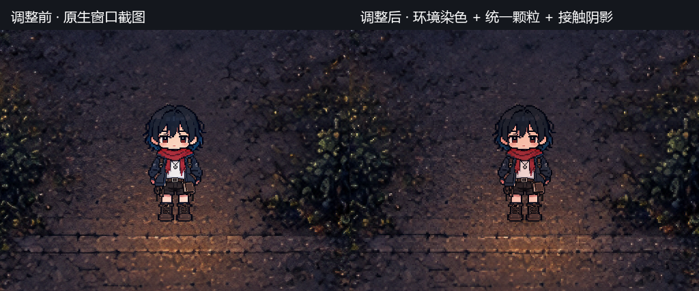
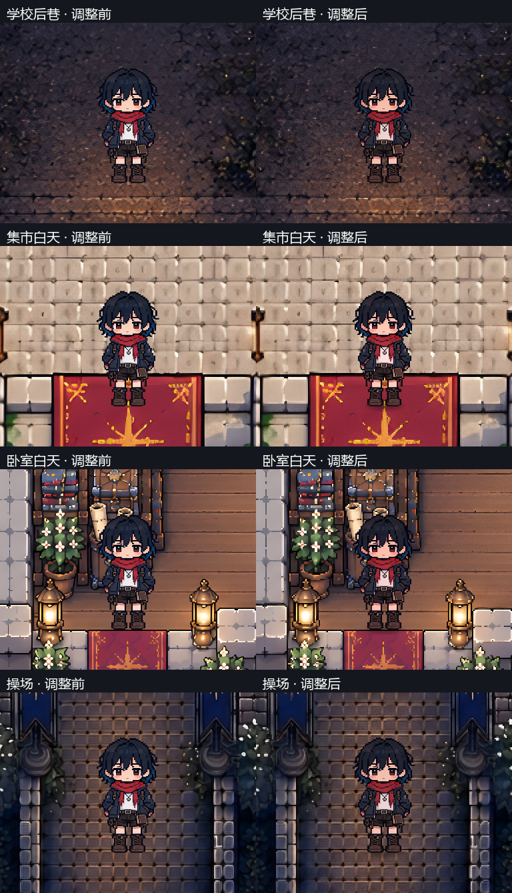

# 角色与环境统一表现（2026-10-24）

最近邻只能阻止采样混色，不能统一美术颗粒：高清、超分背景中仍有大量细碎纹理，而主角是带细描边的像素画。人物不随环境改变亮度和色温，也缺少接触阴影，形成贴纸感。本次在运行时统一世界显示，不重绘素材，不改变人物大小和地图标尺。

## 处理规则

- **共同基格，保留人物细线。** 以 0.25 逻辑像素为基格，人物使用一格，背景、物件、透明前景使用两格。1280×720 时分别为 1 和 2 个物理像素；1920×1080 时为 1.5 和 3 个物理像素。非整数投影会由最近邻栅格化，不承诺任意窗口下都是等宽整数屏幕像素。曾尝试人物也用两格，但眼睛和衣服线条损失明显，未采用。
- **背景颗粒跟随世界，人物颗粒跟随人物。** 材质按地图 `player_scale` 换算，相机仍取倒数。移动时不会让人物内部像素固定在地面上；背景和同源透明前景采样同一组世界位置。UV 导数支持物件旋转、翻转与缩放，图集取样限制在原区域内。
- **人物适应环境。** 从背景生成宽 96 像素的低频缩略图，取脚边 5×5 区域平均色。人物饱和度为 0.88；环境色归一化后限幅，以 28% 强度影响人物冷暖；曝光限制在 0.76–1.0。每 0.12 秒更新，指数平滑避免跨过砖缝或灯色时突变。这是根据静态背景模拟环境色，不是实时灯光或真实遮光计算。
- **落地感。** 脚底增加约 16×5 逻辑像素的阶梯椭圆接触阴影，中心透明度最高 0.32；与人物共用位置、淡出和原有遮挡。
- **共用入口。** 正式游戏、主角、演出人物及编辑器“当前布局试走”共用 `scenes/world_look.gd` 和 `scenes/world_pixel.gdshader`。大地图无可见主角，不套颗粒材质。UI、对话立绘、地图原图、碰撞、剧情和存档坐标保持现有规则。显式自定义材质保留。

## 调整入口

`scenes/world_look.gd` 的 `PIXEL` 管理背景格子，人物取其一半；曝光、染色和饱和度在同文件。`_draw()` 仅画接触阴影。`scenes/map_view.gd` 在室内构建后接入地图材质，`Player.configure_environment()` 在换图后配置人物，演出人物创建后也配置一次。重新打开试走窗口或重新运行游戏，以重建已有节点的材质。

以后若更换动画帧，须继续保持同动画帧的画布大小和图集区域一致。原来的高清源和最近邻规则仍保留，新的颗粒处理仅发生在 GPU 显示阶段。

## 验证

本次提交的隔离暂存快照：游戏 **4383/4383**、插件 **4507/4507**，数据检查和真实窗口烟测通过。含用户原有未提交改动的主工作区：游戏 **4385/4385**、插件 **4507/4507**，编辑器完整探针通过；计数差异未混入提交。

14 张地图的 1280×720 窗口探针 **157/157**；专用 GPU 探针 **25/25**，覆盖四种地图标尺、2×2 实际取样、透明前景无接缝、旋转翻转图集不串色、人物曝光/色温、演出 modulate/完全淡出及编辑器试走。原来的地图、剧情负面用例和引擎资源诊断仍存在，不称日志全净。

运行专用 GPU 探针前，将专用测试进程的 `APPDATA` 指向名字以 `if-between-world-look-` 开头的隔离目录，再运行 `godot --path . --script res://tests/probe_world_look.gd -- --output=<输出目录>`；不要加 `--headless`。图形探针不操作用户桌面。

核验记录见 [verification.json](screenshots/world_look_20261024/verification.json)，另有[全部场景总览](screenshots/world_look_20261024/all_maps_contact.png)、[实际试走画面](screenshots/world_look_20261024/dead_alley_preview.png)及[后巷完整窗口截图](screenshots/world_look_20261024/dead_alley_final_1280x720.png)。前后对照来自修改代码前后的正式最近邻渲染，使用同地图、同出生点及同相机；裁片保持原生像素，不使用线性插值放大。
