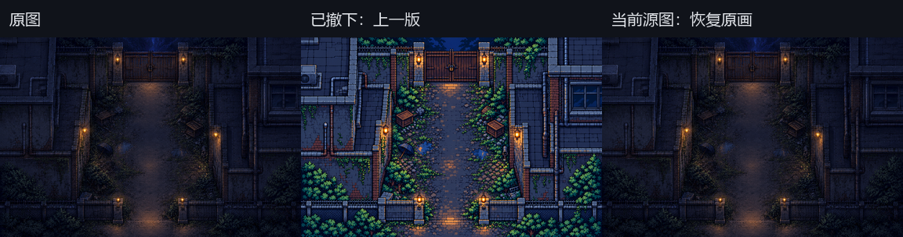
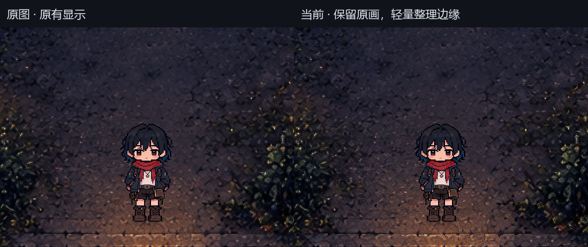
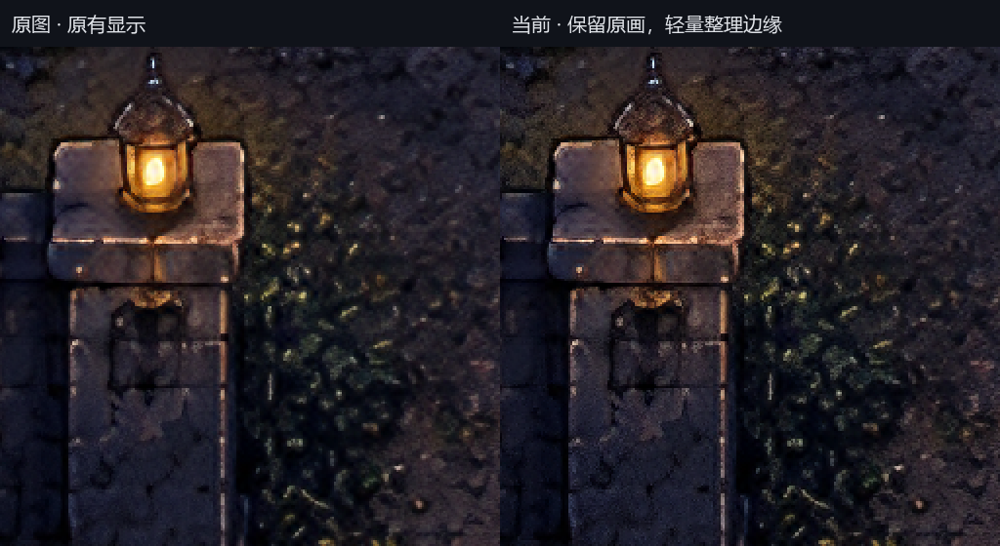
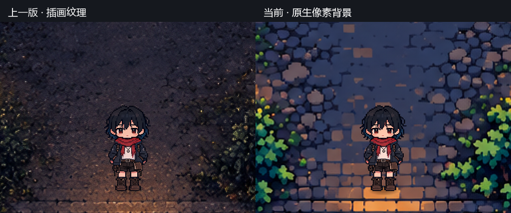
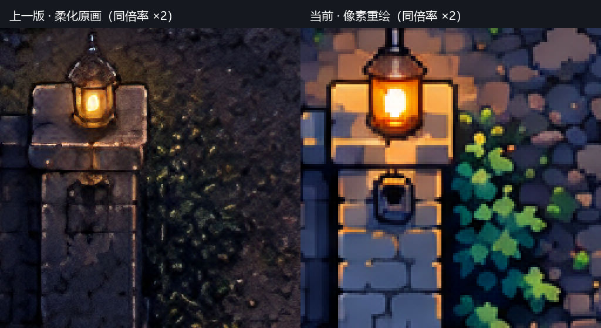
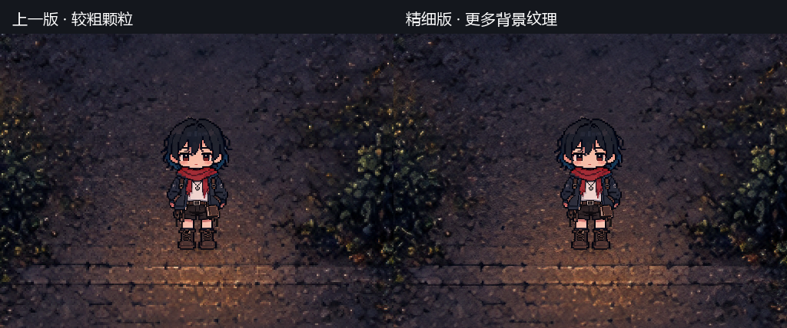

# 角色与环境统一表现（当前：保留后巷原画风格）

用户最新要求：保留原图的整体风格与色调，只允许适度细节调整。上一版按主角风格重绘的背景过亮、蓝绿过艳，已撤下，不再由游戏或编辑器加载。

## 当前接入与实际效果

- 直接使用原始 `art/background/chapter2_dead_alley.png`（4608×3072）。原文件 SHA256 为 `b1d73117ccc9072cc963d9256f2a7f602ac8ae9d5d70c3ef7c5c19c352bd596a`，原图未重写。`PIXEL_REPAINTS` 当前为空，历史亮色重绘只作归档。
- 后巷背景在显示层做有限的局部亮度边缘整理：强度0.6，亮度修正最多0.025，RGB等比增益限定0.8–1.2，并避免高光溢出。平坦区域保留原色，不进行全局提亮、改色温、提高饱和度或重新限色。局部像素亮度会微调，不能称为所有屏幕像素都不变。
- 继续使用0.25逻辑像素细基格与最近邻。1280×720下为1个物理像素，保留砖缝和叶片细节；试验中的2像素粗格及低分辨率重绘均未采用。主角环境取色重新来自原图，原有染色、曝光与接触阴影保持。
- 只在实际原始后巷背景启用边缘整理；其他地图、人物和UI没有套此处理。地图JSON、人物标尺、碰撞与交互坐标不改。游戏与编辑器试走共用显示逻辑；编辑画布显示原画。

这属于保守的清晰度调整，不把绘画原画宣称为已经完成逐像素重绘。原来的暗蓝灰、低饱和植被、旧砖质感和局部暖灯仍以原图为准。四个AI编辑候选在放大后仍有细节软化或色调漂移，全部未接入；最终没有用生成图替代原画。

[干净试走截图](screenshots/original_style_20261024/dead_alley_preview.png) · [入口碰撞核对](screenshots/original_style_20261024/dead_alley_collision_review.png) · [铁门交互核对](screenshots/original_style_20261024/dead_alley_gate_review.png)

## 验证与制作记录

隔离暂存快照：游戏4394/4394、插件4507/4507、数据14图/19剧情/5结局/7物品、真窗口烟测通过；14图GPU157/157、专用GPU31/31。新增GPU行为检查覆盖平坦颜色不变、边缘明暗增强及RGB比例保留。保留既有三条数据提示、负面用例及引擎资源清理诊断。未把并行任务未提交内容纳入发布快照。

[验证数据](screenshots/original_style_20261024/verification.json) · [最终方案与所有试验提示词](../art/catalogs/dead_alley_style_preservation_20261024.json) · [内置image_gen试验提示词纯文本](screenshots/original_style_20261024/imagegen_prompts.txt)

关闭旧试走窗口后重开，或重新运行游戏，以重建背景节点与取色缓存。

---

以下为历史记录，以本节当前方案为准。

# 上一轮记录：后巷原生像素重绘（已撤下）

用户澄清的目标是：背景放大后仍能读出像素造型，不能是糊成团的绘画笔触。前两轮仅调采样颗粒没有解决原画风格，本轮采用原生像素重绘，先处理用户截图里的学校后巷。

## 当前接入

- 新图为 `art/background/chapter2_dead_alley_pixel_20261024.png`，1536×1024，由内置 image_gen 按旧图构图、参照主角原帧的硬边风格作像素重绘。石砖、铁门、草叶和灯具改成清楚的像素造型。旧图原样保留。
- `MapTextureSource.PIXEL_REPAINTS` 解析旧背景路径；`MapView` 按原 384×256 世界范围铺图。编辑画布与实际试走共用新图，地图 JSON、出生点、交互区和碰撞不改。新图缺失或用户改了旧图尺寸时回退旧纹理。
- 原生重绘直接最近邻显示，不套试验中的全局限色或锐化。人物继续使用既有细描边、环境染色、曝光和脚底阴影；环境取色已改为读取实际显示的新图。
- 1280×720 下后巷每个源像素投影约 2 个物理像素；1920×1080 下按现有相机公式约 3 个。此处记录投影关系，实际 GPU 图形验收使用 1280×720。
- 本轮只重绘后巷。其他地图保留既有原画和采样；没有把限色滤镜当作所有地图已经完成像素重绘。

## 构图与碰撞核对

在真实试走中用既有碰撞/交互框核对下方入口、两侧墙线、上方铁门和通路，脚底、地图标尺及交互区域沿用原坐标。生成重绘会改变装饰纹理，不能称为与旧图逐像素一致。

[入口碰撞叠图](screenshots/pixel_style_20261024/dead_alley_collision_review.png) · [铁门交互叠图](screenshots/pixel_style_20261024/dead_alley_gate_review.png) · [干净试走截图](screenshots/pixel_style_20261024/dead_alley_preview.png)

左右是相同游戏窗口、相同地图和相同相机位置的局部截图，均仅以最近邻放大两倍，没有对截图做锐化或模糊。

## 验证与制作记录

仅含本轮暂存内容的隔离快照：游戏 **4392/4392**、插件 **4507/4507**、数据检查 **14/19/5/7**、真窗口烟测通过。主工作区游戏 **4394/4394**；发布快照排除了并行任务尚未导入的猫影素材。14 图 GPU 检查 **157/157**，专用 GPU/试走检查 **28/28**，含新图实际载入、入口和铁门叠图。保留既有数据提示、负面用例和引擎资源清理诊断。

内置 image_gen 的完整最终提示词、输入/输出尺寸与 SHA256 见 [制作记录](../art/catalogs/dead_alley_pixel_repaint_20261024.json)，也保存了[纯文本提示词](screenshots/pixel_style_20261024/imagegen_prompt.txt)。[验证数据](screenshots/pixel_style_20261024/verification.json)与[全场景回归总览](screenshots/pixel_style_20261024/all_maps_contact.png)可供复核。新 PNG 在隔离项目中导入后只同步其专属导入元数据及缓存，没有对正在制作的其他素材强制重导。

重新运行游戏，或关闭旧试走窗口后重开，以重建背景节点和取色缓存。

---

## 以下为前两轮采样与环境融合记录

这些历史对照不代表后巷当前背景；最新接入以上节为准。

最近邻只能阻止采样混色，不能统一美术颗粒：高清、超分背景中仍有大量细碎纹理，而主角是带细描边的像素画。人物不随环境改变亮度和色温，也缺少接触阴影，形成贴纸感。本次在运行时统一世界显示，不重绘素材，不改变人物大小和地图标尺。

## 处理规则

- **共同细基格。** 以 0.25 逻辑像素为基格，人物、背景、物件和透明前景均使用一格。1280×720 时为 1 个物理像素，1920×1080 时为 1.5 个物理像素。非整数投影会由最近邻栅格化，不承诺任意窗口下都是等宽整数屏幕像素。初版背景曾使用两格；用户希望背景更精细后，已改为一格，保留更多砖石、植被和灯光纹理。人物未再加粗。
- **背景颗粒跟随世界，人物颗粒跟随人物。** 材质按地图 `player_scale` 换算，相机仍取倒数。移动时不会让人物内部像素固定在地面上；背景和同源透明前景采样同一组世界位置。UV 导数支持物件旋转、翻转与缩放，图集取样限制在原区域内。
- **人物适应环境。** 从背景生成宽 96 像素的低频缩略图，取脚边 5×5 区域平均色。人物饱和度为 0.88；环境色归一化后限幅，以 28% 强度影响人物冷暖；曝光限制在 0.76–1.0。每 0.12 秒更新，指数平滑避免跨过砖缝或灯色时突变。这是根据静态背景模拟环境色，不是实时灯光或真实遮光计算。
- **落地感。** 脚底增加约 16×5 逻辑像素的阶梯椭圆接触阴影，中心透明度最高 0.32；与人物共用位置、淡出和原有遮挡。
- **共用入口。** 正式游戏、主角、演出人物及编辑器“当前布局试走”共用 `scenes/world_look.gd` 和 `scenes/world_pixel.gdshader`。大地图无可见主角，不套颗粒材质。UI、对话立绘、地图原图、碰撞、剧情和存档坐标保持现有规则。显式自定义材质保留。

## 调整入口

`scenes/world_look.gd` 的 `PIXEL` 管理背景和人物的共同格子；独立的 `SHADOW_PIXEL` 保持阴影原有尺寸与颗粒，不随背景精细化缩小。曝光、染色和饱和度在同文件。`_draw()` 仅画接触阴影。`scenes/map_view.gd` 在室内构建后接入地图材质，`Player.configure_environment()` 在换图后配置人物，演出人物创建后也配置一次。重新打开试走窗口或重新运行游戏，以重建已有节点的材质。

以后若更换动画帧，须继续保持同动画帧的画布大小和图集区域一致。原来的高清源和最近邻规则仍保留，新的颗粒处理仅发生在 GPU 显示阶段。

## 验证

本次提交的隔离暂存快照：游戏 **4383/4383**、插件 **4507/4507**，数据检查和真实窗口烟测通过。含用户原有未提交改动的主工作区：游戏 **4385/4385**、插件 **4507/4507**，编辑器完整探针通过；计数差异未混入提交。

初版 14 张地图的 1280×720 窗口探针 **157/157**；专用 GPU 探针 **25/25**，覆盖四种地图标尺、当时的 2×2 实际取样、透明前景无接缝、旋转翻转图集不串色、人物曝光/色温、演出 modulate/完全淡出及编辑器试走。原来的地图、剧情负面用例和引擎资源诊断仍存在，不称日志全净。

运行专用 GPU 探针前，将专用测试进程的 `APPDATA` 指向名字以 `if-between-world-look-` 开头的隔离目录，再运行 `godot --path . --script res://tests/probe_world_look.gd -- --output=<输出目录>`；不要加 `--headless`。图形探针不操作用户桌面。

核验记录见 [verification.json](screenshots/world_look_20261024/verification.json)，另有[全部场景总览](screenshots/world_look_20261024/all_maps_contact.png)、[实际试走画面](screenshots/world_look_20261024/dead_alley_preview.png)及[后巷完整窗口截图](screenshots/world_look_20261024/dead_alley_final_1280x720.png)。前后对照来自修改代码前后的正式最近邻渲染，使用同地图、同出生点及同相机；裁片保持原生像素，不使用线性插值放大。

## 背景精细化补充

用户反馈背景还可以更精细，本轮将背景格子边长从 0.5 减至 0.25 逻辑像素，在 1280×720 下由 2×2 变成 1×1，单位面积可显示的采样点增加至四倍。使用已有高清源的更多细节，不重新生成素材；人物采样、染色、曝光和阴影保持原效果。

主工作区游戏 **4385/4385**、插件 **4507/4507**、数据检查与真实窗口烟测通过；14 图窗口检查 **157/157**，专用 GPU **25/25**，其中四种标尺现改为核对合成细纹的逐像素保真。原生前后对照及记录如下：

[完整后巷窗口](screenshots/background_detail_20261024/dead_alley_final_1280x720.png) · [核验记录](screenshots/background_detail_20261024/verification.json)
